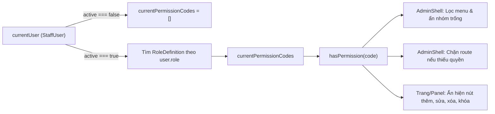

# Tài liệu Frontend Admin — CSKH Cấp Nước

Đối chiếu mã nguồn ngày **23/11/2026**. Tài liệu này mô tả kiến trúc giao diện, cơ chế phân quyền động (RBAC), luồng nghiệp vụ chính và quy ước thiết kế của `cskh-cap-nuoc-frontend-admin` (hiện đang chạy dữ liệu mô phỏng trước khi tích hợp API backend).

## 1. Tổng quan kiến trúc và điều hướng

Ứng dụng sử dụng **Next.js 16 (App Router)** bọc toàn bộ các trang quản trị bên trong `AdminShell` (`components/layout/AdminShell.tsx`), ngoại trừ `/login`.

| Route | Thành phần chính | Quyền truy cập (`permission`) | Chức năng |
|---|---|---|---|
| `/` | `app/page.tsx` | — | Chuyển hướng mặc định tới `/customers` |
| `/login` | `app/login/page.tsx` | Công khai | Màn hình đăng nhập cổng quản trị |
| `/customers` | `app/customers/page.tsx` | `customers.view` | Quản lý liên kết khách hàng và xác thực V2 |
| `/users` | `components/users/UsersPanel.tsx` | `users.view` | Quản lý tài khoản nhân viên, gán vai trò, khóa/mở khóa |
| `/roles` | `components/roles/RolesPanel.tsx` | `roles.view` | Tạo, sửa, nhân bản, xóa vai trò và tích chọn quyền |
| `/permissions` | `components/permissions/PermissionsPanel.tsx` | `permissions.view` | Tra cứu danh mục quyền hệ thống (chỉ đọc) |

## 2. Cơ chế phân quyền động (RBAC)

Trạng thái dùng chung nằm tại `services/AdminStoreContext.tsx` với dữ liệu khởi tạo từ `services/mock-data.ts`:



### Nguyên tắc vận hành phân quyền
1. **Không viết cứng theo tên vai trò:** Sidebar và các màn hình chỉ kiểm tra mã quyền qua `hasPermission(permissionCode)`, không so sánh tên vai trò (`ADMIN`, `CSKH`, `SUPPORT`).
2. **Tài khoản bị khóa (`active: false`):**
   - Trong `AdminStoreContext`, tài khoản bị khóa tự động trả về `currentPermissionCodes = []`.
   - Trong bộ chọn người dùng mẫu trên header (`AdminShell`), các tài khoản đã khóa bị vô hiệu hóa (`disabled`) và gắn nhãn `- Đã khóa`.
3. **Bảo vệ trang đang mở khi đổi người dùng:**
   - Khi chuyển sang tài khoản không có quyền xem route hiện tại, `AdminShell` không render `{children}` mà hiển thị màn hình thông báo **"Bạn không có quyền truy cập trang này"** kèm nút chuyển tới trang đầu tiên trong `visibleNavItems`.
4. **Ma trận quyền theo thao tác nút:**

| Màn hình | Xem trang | Tạo mới / Nhân bản | Sửa thông tin | Xóa / Hủy / Khóa |
|---|---|---|---|---|
| **Khách hàng** | `customers.view` | `customers.create` | `customers.update` | `customers.delete` |
| **Nhân viên** | `users.view` | `users.create` | `users.update` | `users.lock` |
| **Vai trò** | `roles.view` | `roles.create` | `roles.update` | `roles.delete` |
| **Danh mục quyền** | `permissions.view` | — (chỉ đọc) | — (chỉ đọc) | — (chỉ đọc) |

> Lưu ý: Vai trò mặc định (`isSystem: true`) không thể xóa; cột **Thao tác** trong bảng Nhân viên và Vai trò tự động ẩn nếu người dùng hiện tại không có bất kỳ quyền thao tác dòng nào.

## 3. Luồng nghiệp vụ chính

### 3.1. Liên kết khách hàng với đối chiếu V2 (`/customers`)
- **Tạo liên kết mới:**
  1. Nhân viên nhập `customerCode` (mã khách hàng) và `phoneNumber` (số điện thoại), nhấn **Kiểm tra thông tin khách hàng** (hoặc submit form).
  2. Hệ thống chuẩn hóa số điện thoại (`normalizePhone`, bỏ ký tự không phải số, đổi đầu `84` thành `0`), kiểm tra trùng `customerCode` trong danh sách hiện có, rồi đối chiếu cặp `(customerCode, phoneNumber)` với danh bạ V2 mô phỏng (`V2_MOCK_DIRECTORY`).
  3. Nếu khớp, hệ thống tự động điền thông tin tham chiếu từ V2 (`customerName`, `serviceAddress`, `meterNumber`) và mở hộp thoại `ConfirmDialog` để xác nhận lưu.
- **Chỉnh sửa liên kết:** Cho phép cập nhật số điện thoại, số đồng hồ và địa chỉ sử dụng nước (không đổi `customerCode`), có xác nhận qua `ConfirmDialog`.
- **Hủy liên kết:** Xác nhận qua `ConfirmDialog` (`tone="danger"`) trước khi gỡ khỏi danh sách.

### 3.2. Biểu mẫu hợp nhất Vai trò & Gán quyền (`/roles`)
- Tạo mới và chỉnh sửa vai trò dùng chung một biểu mẫu toàn trang (`formMode: "create" | role.id`) gồm thông tin vai trò và `PermissionSelector` (nhóm theo phân hệ, hỗ trợ tìm kiếm, lọc quyền đã chọn và chọn cả nhóm).
- Tự động phát hiện thay đổi chưa lưu (`isDirty`); khi người dùng nhấn quay lại hoặc hủy lúc đang có thay đổi sẽ bật `ConfirmDialog` cảnh báo mất dữ liệu.
- Thanh lưu dính đáy (`sticky bottom-3`) giữ nút **Lưu vai trò** luôn dễ thao tác khi danh sách quyền dài.

## 4. Quy ước UI/UX & Component dùng chung

Chi tiết token màu sắc, typography và thông số thiết kế được ghi tại [DESIGN.md](./DESIGN.md) và [.impeccable/design.json](../.impeccable/design.json). Một số quy ước bắt buộc khi mở rộng giao diện:

- **Lớp phủ toàn màn hình (`ConfirmDialog`, `SlideOver`):** Luôn render qua `createPortal(..., document.body)` để tránh bị CSS stacking context của `animate-fade-in` hoặc `sticky header` (`z-30`) che phủ.
- **Xác nhận & Phản hồi:** Mọi hành động lưu, xóa, khóa/mở khóa, nhân bản và rời biểu mẫu chưa lưu phải đi qua `ConfirmDialog`; sau khi hoàn tất gọi `showSuccessAlert(message)` để hiển thị thông báo toàn cục.
- **Độ dễ đọc dữ liệu:** Dữ liệu bảng dùng cỡ chữ `14px`, các cột số/tiền tệ/ngày giờ dùng `tabular-nums`, mã khách hàng và số đồng hồ dùng font `JetBrains Mono` với `whitespace-nowrap`.
- **Tiết chế màu sắc:** Thanh tìm kiếm/lọc đặt trực tiếp trên nền trang (không bọc card riêng); màu nổi chỉ dùng cho trạng thái hoạt động/khóa, cảnh báo và nút hành động chính.

## 5. Lệnh phát triển và kiểm tra

```bash
npm run dev     # Chạy môi trường phát triển tại http://localhost:3000
npm run lint    # Kiểm tra ESLint và TypeScript rules
npm run build   # Build production (Next.js Turbopack)
```
